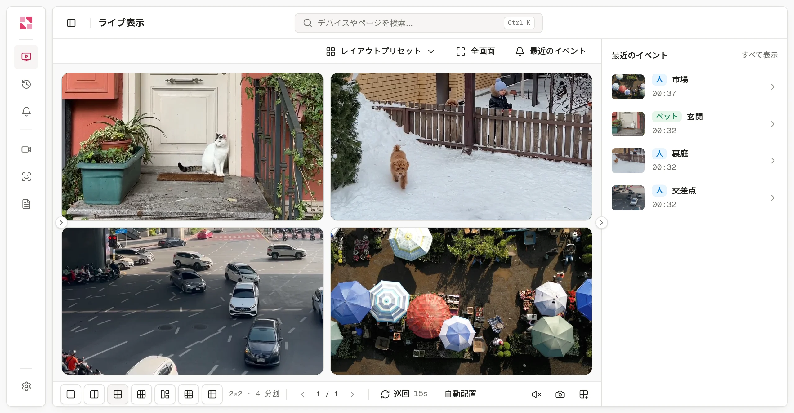
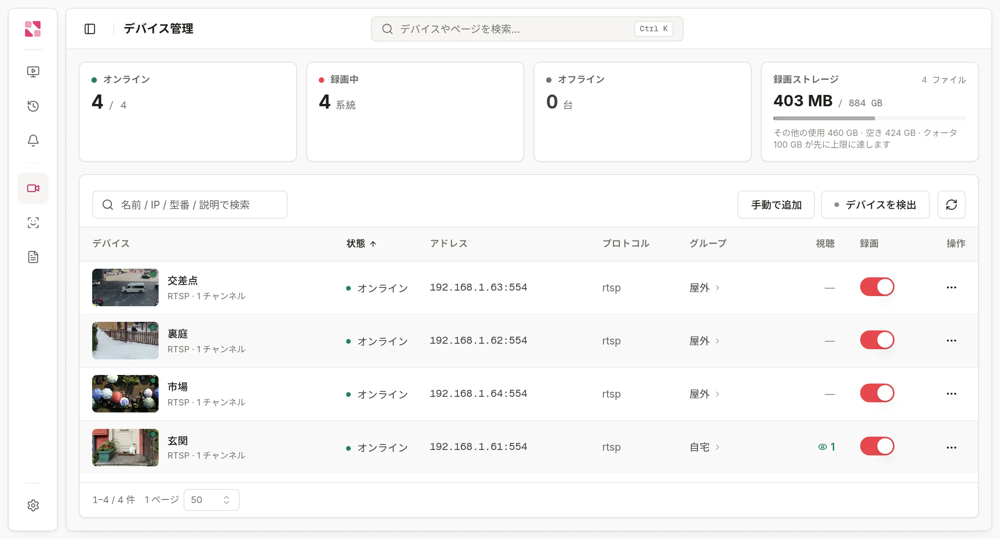
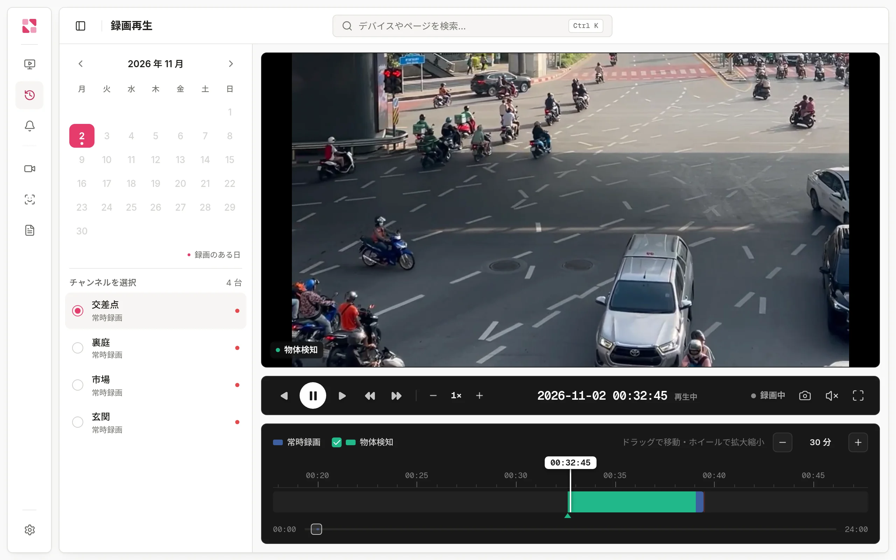
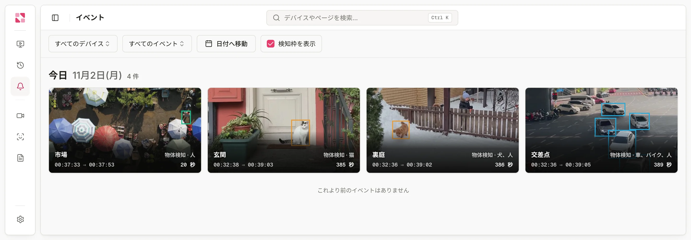

<div align="center">

# Rerinku View

**手持ちのネットワークカメラをつなぐ、セルフホスト型 NVR。**<br>
低遅延のライブ表示、連続録画、ローカルでの AI 認識を、すべて自分のマシンで。

[公式サイト](https://rerinku.com/ja) · [ライブデモ](https://rerinku.com/ja/live) · [ドキュメント](https://rerinku.com/ja/docs/overview) · [リリース](https://github.com/rerinku/rerinku-view/releases)

[English](README.md) · [简体中文](README.zh-CN.md) · 日本語

</div>

<picture>
  <source media="(prefers-color-scheme: dark)" srcset="assets/screenshots/ja/live-dark.webp">
  
</picture>

Rerinku View は、ONVIF、RTSP、GB28181 カメラに対応したセルフホスト型のネットワークビデオレコーダー(NVR)です。自宅、お店、オフィスのネットワークカメラを、自分のパソコン、NAS、ミニ PC に接続します。ライブ映像も録画の再生もブラウザーで見られ、プラグインは必要ありません。映像、録画、認識結果はそのマシンに保存されます。

FFmpeg、AI 認識コンポーネント、リモートアクセス用のトンネルはすべて組み込まれており、ほかに何もインストールする必要はありません。

## クイックスタート

```sh
docker run -d --name rerinku-view \
  --network host \
  --restart unless-stopped \
  -v rerinku-view-data:/data \
  rerinku/view:latest
```

ブラウザーで `http://<ホストの IP>:8080` を開き、[クイックスタート](https://rerinku.com/ja/docs/quickstart)に沿って最初のカメラを追加してください。

- イメージは `linux/amd64` と `linux/arm64` に対応し、非 root ユーザー(UID 65532)で動作します。
- `--network host` を推奨します。ONVIF の検出にはマルチキャストが、WebRTC には動的ポートが必要です。
- データはすべて `/data` ボリュームに保存されます。アップグレードするときは、新しいイメージを取得してコンテナーを作り直してください。
- Intel または AMD の GPU でデコードするには `--device /dev/dri:/dev/dri` を、Linux で USB カメラを使うには `--device /dev/video0:/dev/video0` を追加します。

> [!IMPORTANT]
> 初回起動時に、LAN に向けて 3 つのポートが開きます:**8080**(コンソール)、**1883**(デバイス接続用 MQTT)、**5060**(GB28181 SIP)。
>
> - GB28181 プラットフォームは既定でオンになっており、登録パスワードは `change-me` です。**設定 → GB28181** で変更してください。使わない場合はオフにしてください。
> - コンソールには、設定するまでパスワードがありません。ポート 8080 を信頼できるネットワークの外に公開する前にパスワードを設定するか、リモートアクセスにはクイック接続を使ってください。

## 機能

### ライブ表示

カメラを開くとすぐに映像が表示されます。ブラウザーの WebRTC で再生し、遅延は通常 1 秒以内です。

- 分割レイアウト、レイアウトプリセット、自動巡回
- プレーヤーからの PTZ 操作
- デバイスのグループ分け、カメラごとの複数ストリーム
- ブラウザーが対応していれば H.265 をそのまま転送し、対応していなければサーバーで H.264 に変換(GPU があれば GPU を使用)

### 手持ちのカメラを接続

<picture>
  <source media="(prefers-color-scheme: dark)" srcset="assets/screenshots/ja/devices-dark.webp">
  
</picture>

| 接続方式 | 内容 |
| --- | --- |
| **ONVIF** | LAN 内で自動検出。ユーザー名とパスワードを入力して追加 |
| **RTSP** | ストリームの URL を入力 |
| **GB28181** | デバイスを内蔵の SIP サーバーに登録 |
| **USB カメラ** | 直接接続(Linux のみ) |
| **Rerinku View SDK** | [デバイス SDK](https://rerinku.com/ja/docs/device-sdk) で開発したファームウェアが自ら接続。例:[Luckfox Pico カメラ](https://github.com/rerinku/rerinku-luckfox-pico) |

詳しくは[カメラの接続](https://rerinku.com/ja/docs/cameras)をご覧ください。

### 録画と再生

<picture>
  <source media="(prefers-color-scheme: dark)" srcset="assets/screenshots/ja/playback-dark.webp">
  
</picture>

- カメラごとの連続録画と、日ごとのカレンダーおよび拡大縮小できるタイムライン
- 録画の任意の範囲をクリップとして書き出し
- ストレージの上限に応じて、古い録画から自動で削除
- リモートストレージ(任意)

詳しくは[録画と再生](https://rerinku.com/ja/docs/recording)をご覧ください。

### イベントとローカル AI 認識

<picture>
  <source media="(prefers-color-scheme: dark)" srcset="assets/screenshots/ja/events-dark.webp">
  
</picture>

- 人、車両、ペットを検出し、自分の顔ライブラリーから見知った顔を認識
- 認識は自分のマシンの CPU または対応 GPU で実行
- ONVIF と GB28181 のアラーム、動体検知を 1 つのイベントフィードに集約
- 各イベントの前後の録画を確認し、スマートフォンで通知を受信

詳しくは [AI 認識](https://rerinku.com/ja/docs/ai-recognition)と[イベントと通知](https://rerinku.com/ja/docs/events)をご覧ください。

## ダウンロード

| プラットフォーム | 状況 |
| --- | --- |
| **Docker**(`linux/amd64`、`linux/arm64`) | 提供中:[`rerinku/view`](https://hub.docker.com/r/rerinku/view) |
| **Linux**(x86-64、ARM64) | 提供中:[リリース](https://github.com/rerinku/rerinku-view/releases/latest) |
| **macOS、Windows** パッケージ | 未公開 |
| **Android アプリ**(Rerinku View、Rerinku Cam) | 未公開 |

## ヘルプ

- [ドキュメント](https://rerinku.com/ja/docs/overview)、[よくある質問](https://rerinku.com/ja/docs/faq)、[トラブルシューティング](https://rerinku.com/ja/docs/troubleshooting)
- 質問・不具合の報告:[GitHub Issues](https://github.com/rerinku/rerinku-view/issues)
- [お問い合わせ](https://rerinku.com/ja/about)
