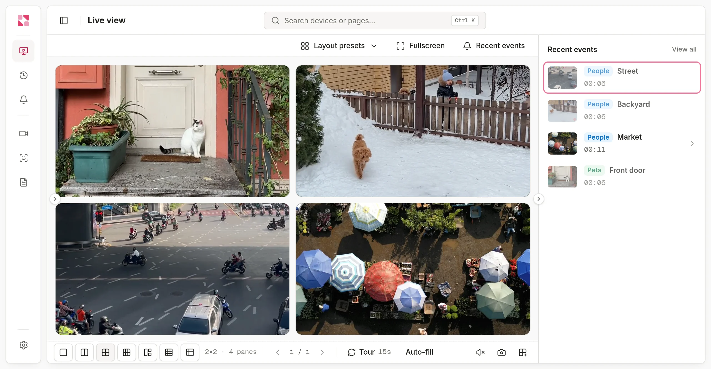
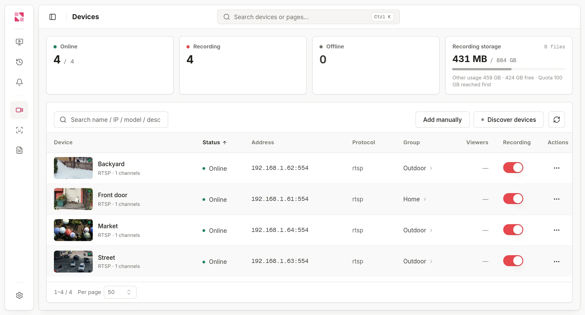
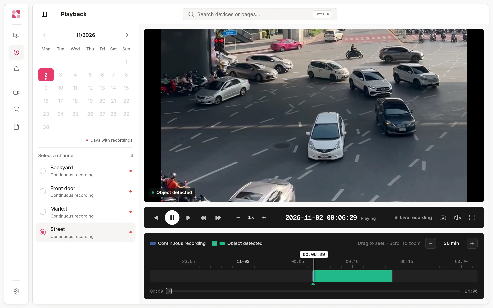
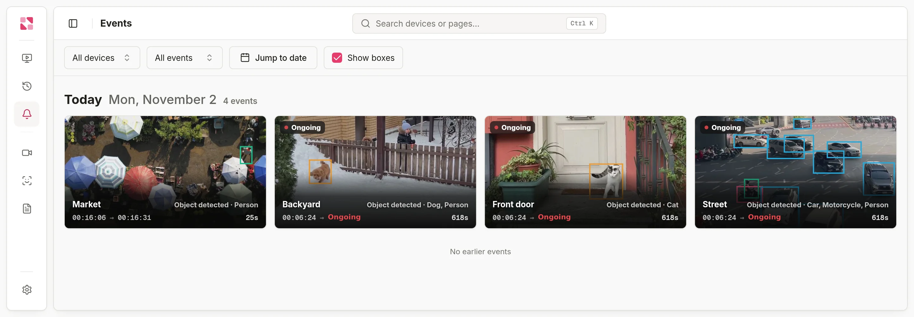

<div align="center">

# Rerinku View

**A self-hosted NVR for your IP cameras.**<br>
Low-latency live view, continuous recording and on-device AI detection, all on a machine you own.

[Website](https://rerinku.com) · [Live demo](https://rerinku.com/live) · [Documentation](https://rerinku.com/docs/overview) · [Releases](https://github.com/rerinku/rerinku-view/releases)

English · [简体中文](README.zh-CN.md) · [日本語](README.ja.md)

</div>

<picture>
  <source media="(prefers-color-scheme: dark)" srcset="assets/screenshots/live-dark.webp">
  
</picture>

Rerinku View connects the cameras in your home, shop or office to a computer, NAS or mini PC of your own. You watch and play back video in a browser, with no plugin to install. Video, recordings and detection results stay on that machine.

FFmpeg, the AI detection components and the remote access tunnel are all built in, so there is nothing else to install.

## Quick start

```sh
docker run -d --name rerinku-view \
  --network host \
  --restart unless-stopped \
  -v rerinku-view-data:/data \
  rerinku/view:latest
```

Then open `http://<host-ip>:8080`. Follow the [quick start guide](https://rerinku.com/docs/quickstart) to add your first camera.

- The image supports `linux/amd64` and `linux/arm64`, and runs as a non-root user (UID 65532).
- `--network host` is recommended: ONVIF discovery relies on multicast, and WebRTC needs dynamic ports.
- All data lives in the `/data` volume. To upgrade, pull the new image and recreate the container.
- For Intel or AMD GPU decoding, add `--device /dev/dri:/dev/dri`. For a USB camera on Linux, add `--device /dev/video0:/dev/video0`.

> [!IMPORTANT]
> On first start, Rerinku View opens three ports to your LAN: **8080** (console), **1883** (MQTT, for devices that connect themselves) and **5060** (GB28181 SIP).
>
> - The GB28181 platform is on by default with the registration password `change-me`. Change it under **Settings → GB28181**, or turn the platform off if you don't use it.
> - The console has no password until you set one. Set a password before exposing port 8080 beyond a trusted network, or use Quick Connect for remote access.

## Features

### Live view

The picture appears as soon as you open a camera. Playback uses WebRTC in the browser, and latency is usually under a second.

- Split layouts, saved layout presets and automatic tours
- PTZ control from the player
- Device groups and multiple streams per camera
- H.265 passed straight through when the browser supports it, otherwise converted to H.264 on the server, using the GPU if available

### Connect the cameras you already have

<picture>
  <source media="(prefers-color-scheme: dark)" srcset="assets/screenshots/devices-dark.webp">
  
</picture>

| Connection | How it works |
| --- | --- |
| **ONVIF** | Discovered automatically on your LAN; enter the username and password to add it |
| **RTSP** | Enter the stream URL |
| **GB28181** | Devices register with the built-in SIP server |
| **USB camera** | Plug in directly (Linux) |
| **Rerinku View SDK** | Firmware built with the [device SDK](https://rerinku.com/docs/device-sdk) connects by itself, such as [this Luckfox Pico camera](https://github.com/rerinku/rerinku-luckfox-pico) |

See [Connecting cameras](https://rerinku.com/docs/cameras).

### Recording and playback

<picture>
  <source media="(prefers-color-scheme: dark)" srcset="assets/screenshots/playback-dark.webp">
  
</picture>

- Continuous recording per camera, with a calendar and a zoomable timeline for each day
- Export a clip from any part of a recording
- Oldest footage is removed automatically according to your storage limit
- Optional remote storage

See [Recording and playback](https://rerinku.com/docs/recording).

### Events and on-device AI

<picture>
  <source media="(prefers-color-scheme: dark)" srcset="assets/screenshots/events-dark.webp">
  
</picture>

- Detects people, vehicles and pets, and recognizes familiar faces from your own face library
- Detection runs on your machine, on the CPU or a supported GPU
- Collects ONVIF and GB28181 alarms and motion detection into one event feed
- Review the footage around each event, and get notified on your phone

See [AI recognition](https://rerinku.com/docs/ai-recognition) and [Events and notifications](https://rerinku.com/docs/events).

### Remote access and integrations

- **Quick Connect:** sign in to Rerinku Cloud to reach your console from anywhere, with no public IP or port forwarding. This is optional, and everything else works without it.
- **Home Assistant and MQTT:** see [Integrations](https://rerinku.com/docs/integrations).
- **Open API and read-only view tokens:** embed live video in your own pages with the [Web SDK](https://rerinku.com/docs/web-sdk).
- **Console:** English, 中文 and 日本語, light and dark themes, global search and an audit log.

<sub>Screenshots are from v0.1.0. Stock footage from Pexels stands in for real cameras.</sub>

## Downloads

| Platform | Status |
| --- | --- |
| **Docker** (`linux/amd64`, `linux/arm64`) | Available: [`rerinku/view`](https://hub.docker.com/r/rerinku/view) |
| **Linux** (x86-64, ARM64) | Available: [Releases](https://github.com/rerinku/rerinku-view/releases/latest) |
| **macOS, Windows** packages | Not published yet |
| **Android apps** (Rerinku View, Rerinku Cam) | Not published yet |

## Help

- [Documentation](https://rerinku.com/docs/overview), [FAQ](https://rerinku.com/docs/faq) and [Troubleshooting](https://rerinku.com/docs/troubleshooting)
- [Contact us](https://rerinku.com/about)
