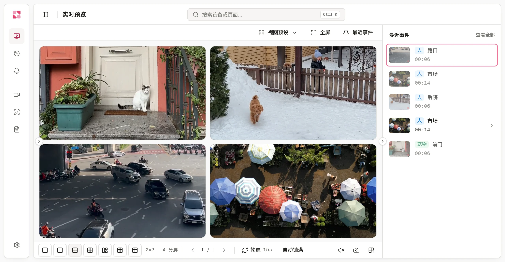
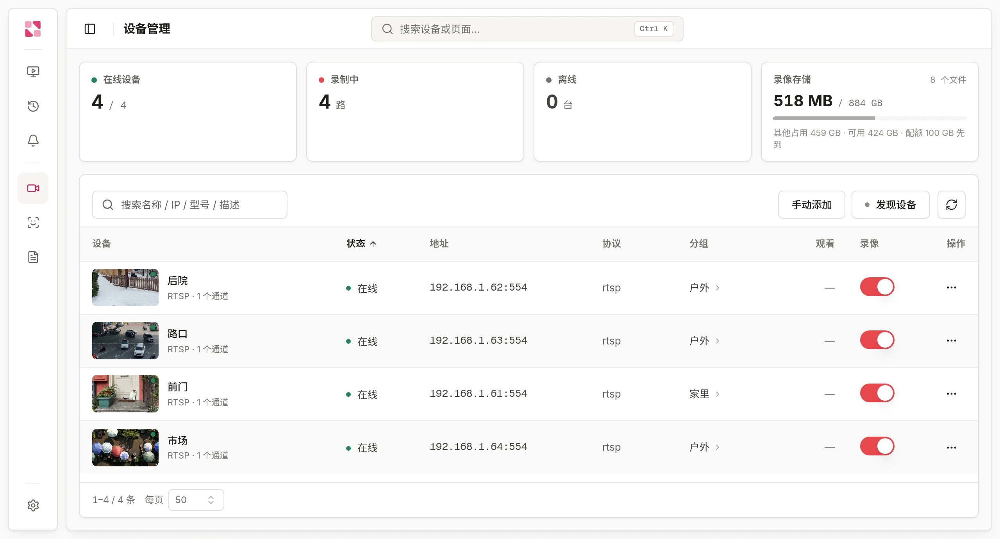
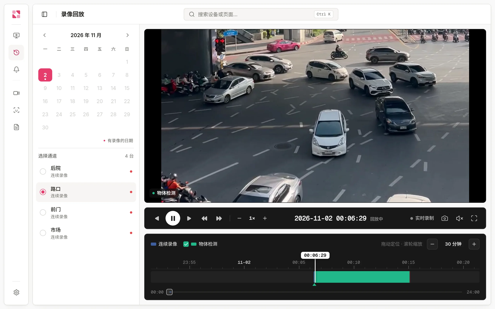
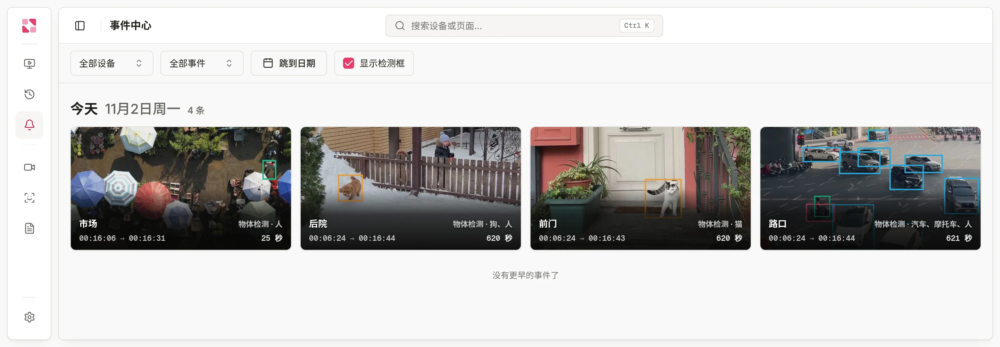

<div align="center">

# Rerinku View

**跑在你自己机器上的 NVR,接入你手里的网络摄像头。**<br>
低延迟实时画面、持续录像、本机 AI 识别,全部在你自己的机器上完成。

[官网](https://rerinku.com/zh) · [在线演示](https://rerinku.com/zh/live) · [文档](https://rerinku.com/zh/docs/overview) · [版本发布](https://github.com/rerinku/rerinku-view/releases)

[English](README.md) · 简体中文 · [日本語](README.ja.md)

</div>

<picture>
  <source media="(prefers-color-scheme: dark)" srcset="assets/screenshots/zh/live-dark.webp">
  
</picture>

Rerinku View 是自托管的网络视频录像机(NVR),支持 ONVIF、RTSP 和国标 GB28181 摄像头,把家里、店里或办公室的网络摄像头接到你自己的电脑、NAS 或迷你主机上。看实时画面和回放都在浏览器里,不用装插件。视频、录像和识别结果都留在这台机器上。

FFmpeg、AI 识别组件和远程访问隧道都已内置,不用再装其他东西。

## 快速开始

```sh
docker run -d --name rerinku-view \
  --network host \
  --restart unless-stopped \
  -v rerinku-view-data:/data \
  rerinku/view:latest
```

然后在浏览器打开 `http://<宿主机 IP>:8080`,再按[快速开始指南](https://rerinku.com/zh/docs/quickstart)添加第一台摄像头。

- 镜像支持 `linux/amd64` 和 `linux/arm64`,以非 root 用户(UID 65532)运行。
- 建议使用 `--network host`:ONVIF 发现依赖组播,WebRTC 需要动态端口。
- 所有数据都在 `/data` 卷里。升级时拉取新镜像并重建容器即可。
- 用 Intel 或 AMD 显卡解码时,加上 `--device /dev/dri:/dev/dri`。在 Linux 上接 USB 摄像头时,加上 `--device /dev/video0:/dev/video0`。

> [!IMPORTANT]
> 首次启动后,Rerinku View 会向局域网开放三个端口:**8080**(控制台)、**1883**(MQTT,供设备主动接入)和 **5060**(国标 GB28181 SIP)。
>
> - 国标平台默认开启,注册密码是 `change-me`。请在 **设置 → 国标接入** 里修改;不用国标的话,直接关闭。
> - 控制台默认没有密码。把 8080 端口开放到可信网络之外前,请先设置访问密码;需要远程访问时,也可以用「快速连接」。

## 功能

### 实时画面

打开摄像头就能看到画面。浏览器里用 WebRTC 播放,延迟通常在 1 秒以内。

- 多种分屏布局,可保存视图预设,支持自动轮巡
- 在播放器里直接控制云台
- 设备分组,每台摄像头可接多路码流
- 浏览器支持 H.265 时直接透传,不支持时由服务端转成 H.264,有显卡就用显卡

### 接入你已有的摄像头

<picture>
  <source media="(prefers-color-scheme: dark)" srcset="assets/screenshots/zh/devices-dark.webp">
  
</picture>

| 接入方式 | 说明 |
| --- | --- |
| **ONVIF** | 局域网自动发现,输入用户名和密码即可添加 |
| **RTSP** | 填写流地址 |
| **国标 GB28181** | 设备注册到内置的 SIP 服务器 |
| **USB 摄像头** | 直接连接(仅 Linux) |
| **Rerinku View SDK** | 用[设备 SDK](https://rerinku.com/zh/docs/device-sdk) 开发的固件会主动接入,例如这个 [Luckfox Pico 摄像头](https://github.com/rerinku/rerinku-luckfox-pico) |

详见[接入摄像头](https://rerinku.com/zh/docs/cameras)。

### 录像与回放

<picture>
  <source media="(prefers-color-scheme: dark)" srcset="assets/screenshots/zh/playback-dark.webp">
  
</picture>

- 每台摄像头可单独开启持续录像,按天查看日历和可缩放的时间轴
- 录像的任意一段都可以导出
- 按存储上限自动清理最早的录像
- 可选远端存储

详见[录像与回放](https://rerinku.com/zh/docs/recording)。

### 事件与本机 AI 识别

<picture>
  <source media="(prefers-color-scheme: dark)" srcset="assets/screenshots/zh/events-dark.webp">
  
</picture>

- 识别人、车辆和宠物,并通过你自己的人脸库认出熟悉的面孔
- 识别在你的机器上运行,可用 CPU 或受支持的显卡
- ONVIF、国标报警和运动检测汇总到同一个事件流
- 可回看每个事件前后的录像,并接收手机推送

详见 [AI 识别](https://rerinku.com/zh/docs/ai-recognition)和[事件与通知](https://rerinku.com/zh/docs/events)。

## 下载

| 平台 | 状态 |
| --- | --- |
| **Docker**(`linux/amd64`、`linux/arm64`) | 可用:[`rerinku/view`](https://hub.docker.com/r/rerinku/view) |
| **Linux**(x86-64、ARM64) | 可用:[版本发布](https://github.com/rerinku/rerinku-view/releases/latest) |
| **macOS、Windows** 安装包 | 尚未发布 |
| **安卓 App**(Rerinku View、Rerinku Cam) | 尚未发布 |

## 帮助

- [文档](https://rerinku.com/zh/docs/overview)、[常见问题](https://rerinku.com/zh/docs/faq)和[故障排查](https://rerinku.com/zh/docs/troubleshooting)
- 提问和反馈问题:[GitHub Issues](https://github.com/rerinku/rerinku-view/issues)
- [联系我们](https://rerinku.com/zh/about)
